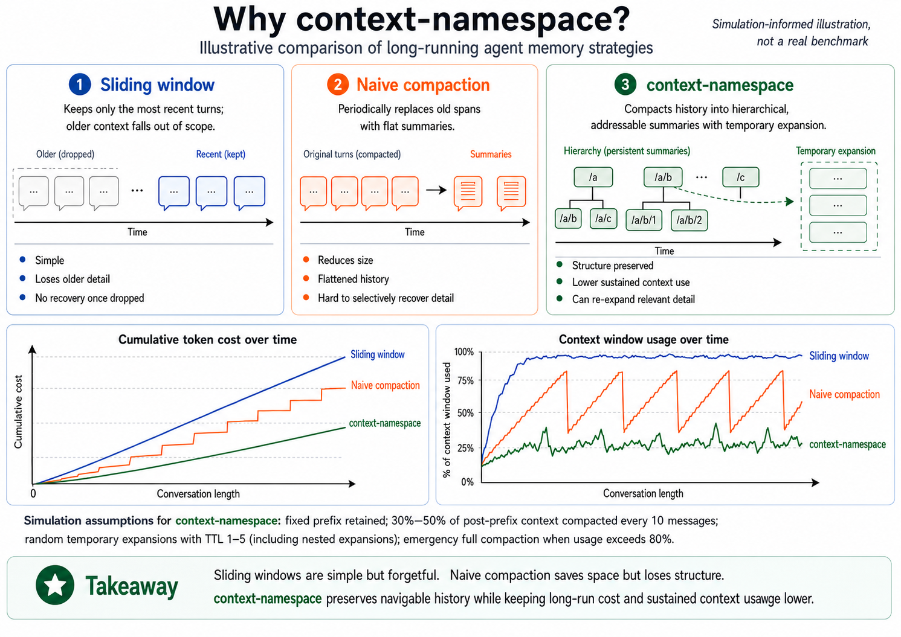
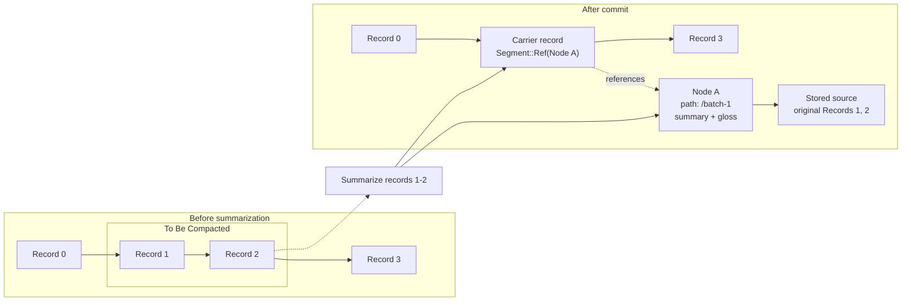
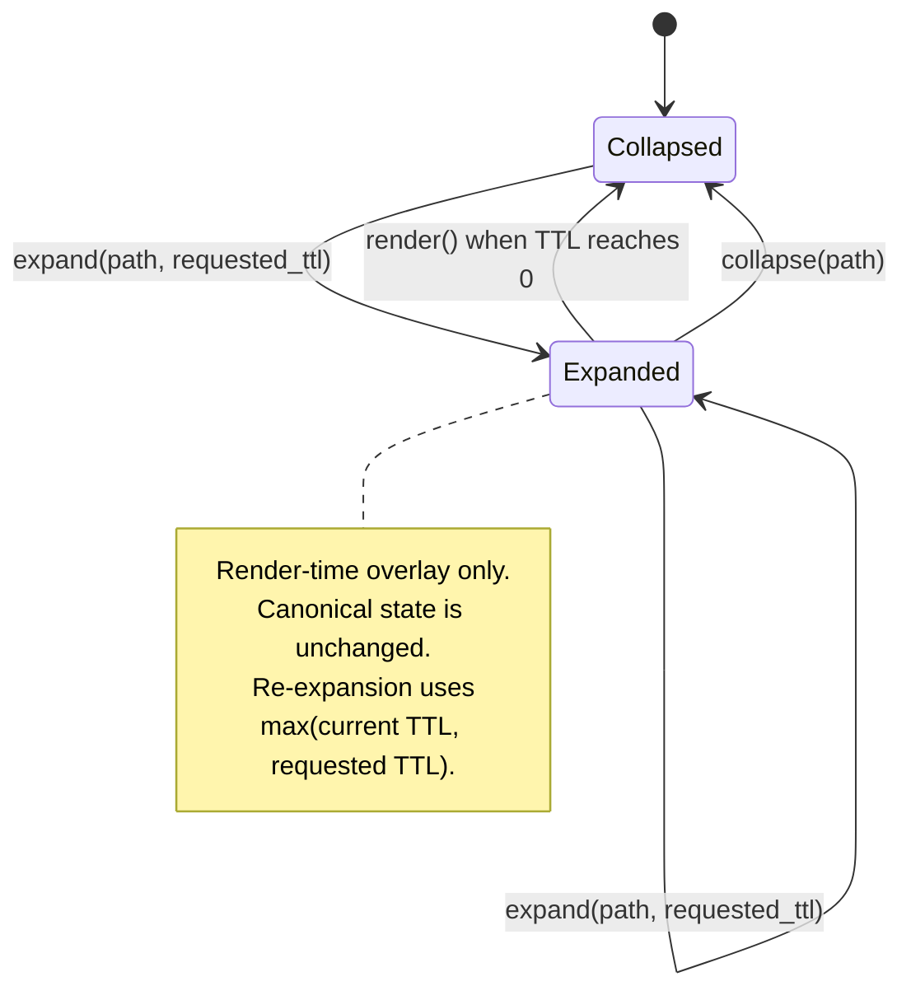
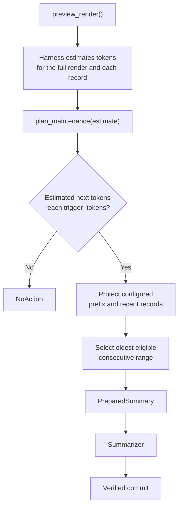
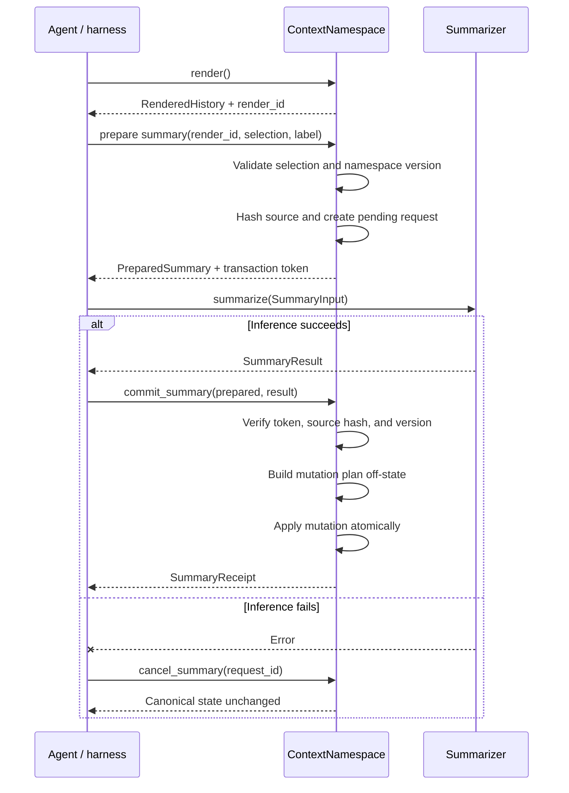

# context-namespace


Hierarchical, path-addressable context compaction for LLM agents.

## Overview

`context-namespace` is a deterministic data structure for managing ordered agent-history records with nested,
path-addressable summaries. An agent compresses old history into summary nodes arranged in a tree, expands individual
nodes temporarily for inspection, and renders structured JSON with stable record ordering for model consumption. A
maintenance policy can trigger automatic summarization based on harness-supplied token estimates.

The library is written in Rust (1.85+, Edition 2024) with optional Python bindings via PyO3. The core crate has no
Python dependency.

## Why `context-namespace`?



## How Compaction Works



Summarization changes the active record sequence, but it does not discard the summarized material. The original source
is retained inside the summary node and the record sequence receives a lightweight reference to that node.



Expansion is a temporary render overlay over compacted state. It does not modify the canonical records or summary tree.
An expanded node changes what the next few renders contain; it does not undo the summary or restore its source records
to the canonical sequence.

## `context-namespace`/Host Application Division

Automatic maintenance keeps token accounting outside the library while keeping policy decisions deterministic and
verifiable. `preview_render()` exposes the current rendered form and stable per-record fragments, which the host uses to
estimate model-specific token counts. Those estimates are passed back to `plan_maintenance()`, where the library
verifies that they still match the current namespace state, checks the configured trigger threshold, protects the
configured prefix and most-recent records, and selects the oldest eligible consecutive range for summarization.

If maintenance is not needed, the library returns `NoAction`. If compaction is triggered, it produces a prepared summary
request that follows the same transactional summarization path as an explicit user-requested summary: external inference
produces the summary text, and the result is validated and committed atomically.



## Key concepts

| Concept               | Description                                                                                                                                                                                                                                           |
| --------------------- | ----------------------------------------------------------------------------------------------------------------------------------------------------------------------------------------------------------------------------------------------------- |
| **Record**            | One entry in the canonical ordered sequence. Each record has a stable immutable `RecordId` and a render field (e.g. `"content"`) that the model sees.                                                                                                 |
| **Summary node**      | A tree node that replaces a range of records or a text slice. Each node stores summary text, a short gloss, provenance (source and result hashes), and the compressed source material. Nodes are path-addressable (e.g. `/batch-1/sub-analysis`).     |
| **Carrier record**    | A synthetic record that replaces a summarized record range. Its render field is a `Segment::Ref` pointing to the new summary node. When rendered collapsed, it shows `[summary(/path): <summary>; gloss(/child-path): <gloss>, ...]`; when expanded, the referenced node's stored source text is inlined in place of the marker.      |
| **Expansion**         | A temporary overlay that inlines a summary node's stored source text in the rendered output for _N_ renders. TTL decrements after each successful render and auto-collapses at zero. Canonical state is never modified by expansion.             |
| **Namespace version** | A monotonic counter that increments on canonical mutations such as append and summary commit. Snapshot restore preserves the version stored in the snapshot. Rendering, validation, snapshots, previews, expansion, and collapse do not increment it. |
| **Render ID**         | A unique `RenderId` allocated on each `render()` call. Used to validate that visible indices passed to `prepare_*` are still current.                                                                                                                 |
| **Prepared summary**  | A hash-bound transaction handle returned by `prepare_record_summary` or `prepare_text_summary`. It carries an unforgeable `TransactionToken` that `commit_summary` revalidates before applying the mutation.                                          |

## Workspace layout

```text
crates/
  context-namespace/        # Core Rust library (no Python dependency)
    src/
      lib.rs                # Crate root, re-exports
      config.rs             # NamespaceConfig, DefensiveLimits, PolicyConfig, etc.
      namespace.rs          # ContextNamespace — central state machine
      record.rs             # NewRecord, Record, Segment
      node.rs               # NamespaceNode, NodeSource, NodeDescriptor
      path.rs               # NamespacePath, NodeLabel, NodeLocator, PathError
      summary.rs            # RecordSelection, TextSelection, PreparedSummary, etc.
      transaction.rs        # TransactionToken, PendingSummary, SummaryMutationPlan
      render.rs             # RenderedHistory, RenderPreview, MaintenanceUnit
      snapshot.rs           # SnapshotBytes, RestoreOptions, NamespaceSnapshotV1
      policy.rs             # validate_config
      validation.rs         # validate(), InvariantViolation, ValidationReport
      error.rs              # NamespaceError, WorkflowError
      event.rs              # NamespaceEvent, StructuralStats
      id.rs                 # RecordId, NodeId, RenderId, RequestId, ContentHash
      receipt.rs            # AppendReceipt, SummaryReceipt, ExpansionReceipt, etc.
      simple.rs             # SimpleContextNamespace, Capabilities, NodeFilter
      adapter.rs            # Summarizer trait, async workflow helpers (async-adapters feature)
      embedding.rs          # Embedding types (semantic-search feature)
    tests/                  # Integration and property tests
    benches/                # Criterion benchmarks
  context-namespace-py/     # PyO3 binding cdylib (_native module)
python/
  context_namespace/        # Stdlib-only Python facade package
    __init__.py             # Public API re-exports
    facade.py               # ContextNamespace class wrapping _NativeNamespace
    config.py               # NamespaceConfig and sub-config dataclasses
    models.py               # DTO dataclasses (AppendReceipt, SummaryReceipt, etc.)
    errors.py               # Python exception hierarchy
    protocols.py            # Summarizer, Embedder runtime-checkable protocols
    _native.pyi             # Type stubs for the _native PyO3 extension
tests/
  python/                   # Python integration tests
docs/                       # Diátaxis documentation
```

## Features

| Feature           | Default | Adds                                                                                     |
| ----------------- | :-----: | ---------------------------------------------------------------------------------------- |
| `json-schema`     |   Yes   | The `schemars` dependency (no JSON Schema derives are currently generated)               |
| `async-adapters`  |   Yes   | `Summarizer` trait and high-level async workflow methods                                 |
| `semantic-search` |   No    | Embedding and search data types (full semantic search functionality not yet implemented) |
| `tracing`         |   No    | `tracing` integration support (instrumentation not yet implemented)                      |

## Installation

### Rust

```sh
cargo add context-namespace
```

### Python

```sh
python -m pip install context-namespace
```

## Building and testing

### Rust

```sh
# Build all crates
cargo build --workspace

# Run all tests (including property tests)
cargo test --workspace --all-features

# Lint
cargo clippy --workspace --all-features --all-targets -- -D warnings

# Format check
cargo fmt --all -- --check

# Build documentation (warnings as errors)
RUSTDOCFLAGS="-D warnings" cargo doc --workspace --all-features
```

### Python

```sh
# Build and install the Python wheel in development mode
maturin develop --manifest-path crates/context-namespace-py/Cargo.toml

# Run Python tests
python -m pytest tests/python/ -v
```

## Implemented capabilities

### Core library (`ContextNamespace`)

- **Construction**: `ContextNamespace::new(config)` and `from_records(config, records)` create a namespace from a
  configuration and optional initial records. Config validation rejects empty render fields, invalid policy
  relationships (trigger < target, budget < trigger), and invalid TTL defaults.
- **Append**: `append(NewRecord)` adds a record with a stable immutable `RecordId` (UUID v7). Returns an `AppendReceipt`
  with the record ID and visible index. Enforces `max_records` limit.
- **Record-range summarization**: `prepare_record_summary(RecordSelection, NodeLabel)` validates a consecutive record
  range against a fresh render ID, extracts source text, and returns a `PreparedSummary` with an unforgeable
  `TransactionToken`. `commit_summary(PreparedSummary, SummaryResult)` revalidates the token, source hash, and version,
  then replaces the range with a synthetic carrier record. `cancel_summary(RequestId)` removes a pending request without
  mutating canonical state.
- **Text-slice summarization**: `prepare_text_summary(TextSelection, NodeLabel)` validates a Unicode scalar-value
  character range within one record's render field and commits via the same `commit_summary` path. The `RecordLocator`
  enum locates the target record by stable ID or by visible index bound to a render ID.
- **Expansion**: `expand(path, ttl_renders)` activates a summary node for _N_ successful renders. Re-expansion takes
  `max(current, requested)` — it never shortens an active TTL. Enforces `max_active_expansions` and `max_expansion_ttl`
  limits. `collapse(NodeId)` clears the overlay immediately. `is_expanded(NodeId)` queries the current state.
- **Rendering**: `render()` produces structured JSON with stable record ordering and a fresh `RenderId`, with an
  optional envelope, visible indices, stable record IDs (`__ctx` metadata), and expansion overlays. The `IndexMode`
  config controls which index metadata is injected (`None`, `RecordId`, `VisibleIndex`, `Both`). Pretty-printing is
  available via `RenderOptions::pretty`.
- **Maintenance planning**: `preview_render()` produces a non-mutating render preview with per-record `MaintenanceUnit`
  entries (record ID, SHA-256 render digest, JSON fragment) for token estimation. It does not allocate a render ID,
  register resolutions, emit events, or decrement TTLs. `plan_maintenance(MaintenanceInput)` validates harness-supplied
  per-record estimates, checks the trigger threshold, selects the oldest eligible consecutive range respecting
  `preserve_prefix_records` and `preserve_recent_records`, and returns a `MaintenanceDecision::Summarize` or `NoAction`.
- **Inspection**: `list_nodes()` returns descriptors for all nodes in the tree. `inspect_node(NodeLocator)` looks up a
  node by path or ID. `resolve_path(path)` returns the node ID for a current path. `current_path(node_id)` returns the
  current absolute path for a node. `stats()` returns a `StructuralStats` snapshot with record/node counts, active
  expansions, pending requests, alias count, max depth, and dropped events.
- **Validation**: `validate()` checks all 12 namespace invariants and returns a `ValidationReport`. Returns
  `InvariantViolation` on failure.
- **Snapshots**: `snapshot()` serializes state to versioned JSON with a SHA-256 content hash (`SnapshotBytes`).
  `restore(bytes, RestoreOptions)` rebuilds a namespace from snapshot bytes with full invariant validation and
  schema-version checking. Pending requests are excluded from snapshots. Expansion state is preserved.
- **Events**: `drain_events(limit)` returns typed `NamespaceEvent` operation receipts from a bounded internal queue.
  When the queue is full, oldest events are dropped and `dropped_events` in `StructuralStats` is incremented.

### High-level API (`SimpleContextNamespace`)

Wraps `ContextNamespace` in `Arc<Mutex<...>>` for ergonomic use. Provides simplified methods: `append(role, content)`,
`render()`, `summarize_records()` (async, releases the lock during inference), `expand(path, ttl)`, `collapse(path)`,
`is_expanded(path)`, `list_nodes(filter)`, `validate()`, `snapshot()`, `restore()`, `capabilities()`, `version()`,
`stats()`.

### Async adapters (`async-adapters` feature)

The `Summarizer` trait defines `async fn summarize(SummaryInput) -> SummaryResult`. Three high-level async workflow
methods on `ContextNamespace` combine prepare, inference, and commit into a single awaitable call:

- `summarize_records_with(selection: RecordSelection, label: NodeLabel, &summarizer)`
- `summarize_text_with(selection: TextSelection, label: NodeLabel, &summarizer)`
- `maintain_with(input: MaintenanceInput, &summarizer)`

If the summarizer raises, the pending request is cancelled and state is not mutated.

### Python bindings

The Python facade (`context_namespace` package) wraps the native extension module with:

- `ContextNamespace` facade covering the primary namespace operations
- `NamespaceConfig` and sub-config dataclasses (frozen, slotted, stdlib-only)
- Frozen, slotted DTO dataclasses for the Python-facing receipts, previews, estimates, and descriptors
- `Summarizer` and `Embedder` runtime-checkable protocols
- Python exception hierarchy mapping native namespace failures
- Automatic error mapping from native exceptions to Python exceptions

## Rust usage example

```rust
use context_namespace::{
    ContextNamespace, NamespaceConfig, NewRecord, NodeLabel,
    RecordSelection, RestoreOptions, SummaryResult,
};
use indexmap::IndexMap;

// Create a namespace with default configuration.
let mut ns = ContextNamespace::new(NamespaceConfig {
    render_field: "content".to_string(),
    ..Default::default()
}).expect("valid config");

// Append records.
for i in 0..5 {
    let mut fields = IndexMap::new();
    fields.insert("content".to_string(), serde_json::json!(format!("record {i}")));
    fields.insert("role".to_string(), serde_json::json!("user"));
    ns.append(NewRecord::new(fields, "content",
        &context_namespace::DefensiveLimits::default()).unwrap()).unwrap();
}

// Render to get a fresh render ID.
let view = ns.render().expect("render");

// Summarize records 0-2.
let label = NodeLabel::new("first-summary",
    &ns.config().limits).expect("valid label");
let prepared = ns.prepare_record_summary(RecordSelection {
    render_id: view.render_id,
    start_index: 0,
    end_index: 3,
}, label).expect("prepare");

ns.commit_summary(prepared, SummaryResult {
    summary: "Summary of records 0-2".to_string(),
    gloss: "First three records".to_string(),
}).expect("commit");

// Expand the summary node for 2 renders.
let path = context_namespace::NamespacePath::parse("/first-summary",
    &ns.config().limits).expect("valid path");
ns.expand(&path, 2).expect("expand");
let _expanded = ns.render().expect("render with expansion");

// Validate invariants.
ns.validate().expect("invariants hold");

// Snapshot and restore.
let snapshot = ns.snapshot().expect("snapshot");
let (restored, _receipt) = ContextNamespace::restore(
    snapshot.data(),
    RestoreOptions::default(),
).expect("restore");
assert_eq!(restored.version(), ns.version());
```

## Python usage example

```python
import asyncio
from context_namespace import (
    ContextNamespace,
    NamespaceConfig,
    SummaryResult,
)


class StubSummarizer:
    async def summarize(self, request):
        return SummaryResult(
            summary=f"Summary of {len(request.source)} chars",
            gloss="test-gloss",
        )


ns = ContextNamespace(config=NamespaceConfig())
for i in range(5):
    ns.append({"role": "user", "content": f"record {i}"})

view = ns.render()
receipt = asyncio.run(
    ns.summarize_records(
        render_id=view.render_id,
        start_index=0,
        end_index=3,
        label="batch-1",
        summarizer=StubSummarizer(),
    )
)
print(f"Created node: {receipt.node_id}")
print(f"Records remaining: {ns.stats().records}")

snap = ns.snapshot()
restored = ContextNamespace.restore(snap)
assert restored.version == ns.version
```

## Transactional model

Summary commits use a two-phase transaction:

1. **Prepare**: `prepare_record_summary` or `prepare_text_summary` validates the selection against current canonical
   state. Visible-index selections are additionally bound to a valid render ID. The operation then extracts source text,
   computes a source hash, and returns a `PreparedSummary` with a hash-bound `TransactionToken`.
2. **Commit**: `commit_summary` revalidates the token, source hash, and namespace version, then applies the mutation
   atomically — replacing a record range with a carrier record or replacing a text slice with a structural reference,
   creating the summary node, updating parent/child links, and recording path aliases for moved child nodes. A stale
   request returns `NamespaceError::StaleSummary` without mutating state.

`cancel_summary(request_id)` removes a pending request without mutating canonical state.



The high-level Rust and Python APIs perform the prepare, inference, commit, and cancellation steps for you. The
lower-level transaction API is available when a harness needs explicit control.

## Error handling

Most fallible `ContextNamespace` operations return `Result<_, NamespaceError>`. Full invariant validation returns
`InvariantViolation`, while high-level async workflows wrap inference failures and core namespace errors in
`WorkflowError<E>`.

| Variant              | Cause                                                                                                                        |
| -------------------- | ---------------------------------------------------------------------------------------------------------------------------- |
| `MissingRenderField` | A record does not contain the configured render field as a string.                                                           |
| `StaleRender`        | A render ID is unknown, expired from the retained render history, or no longer matches the current namespace version.        |
| `StaleSummary`       | A prepared summary request is missing or no longer valid for the current namespace state.                                    |
| `UnknownPath`        | A namespace path or node ID does not resolve to a live node.                                                                 |
| `PathCollision`      | A new node path collides with an existing current path or retained alias.                                                    |
| `InvalidSelection`   | A record range, text range, locator, or other selection is invalid or out of bounds.                                         |
| `PolicyViolation`    | Maintenance input or another operation violates an enforced policy constraint.                                               |
| `EmbeddingMismatch`  | Embedding dimensions or model identity do not match the expected embedding configuration.                                    |
| `SnapshotVersion`    | A snapshot uses an unsupported schema version.                                                                               |
| `Invariant`          | Corrupt or inconsistent state was detected while restoring, decoding, or otherwise processing namespace state.               |
| `LimitExceeded`      | A configured defensive limit such as record count, node count, render size, pending requests, or expansion TTL was exceeded. |
| `Config`             | Namespace configuration is invalid, such as an empty render field or inconsistent policy settings.                           |
| `InvalidSummary`     | A summarizer returned a result that fails validation, such as exceeding configured summary or gloss limits.                  |

`validate()` reports structural consistency failures separately as `InvariantViolation`. High-level async methods return
`WorkflowError<E>`, which distinguishes an external summarizer inference failure from an underlying `NamespaceError`.

The Python bindings map native failures into a Python exception hierarchy rooted at `ContextNamespaceError`, with more
specific exceptions such as `InvalidSelectionError`, `StaleRenderError`, `UnknownPathError`, and `SnapshotVersionError`.

## Documentation

Full documentation follows the [Diátaxis](https://diataxis.fr) framework:

- **Tutorial**:
  [Getting started](https://github.com/dingo-actual/context-namespace/blob/main/docs/tutorials/getting-started.md)
- **How-to guides**:
  [High-level API](https://github.com/dingo-actual/context-namespace/blob/main/docs/howtos/high-level-api.md),
  [Text-slice summarization](https://github.com/dingo-actual/context-namespace/blob/main/docs/howtos/summarize-text-slice.md),
  [Async workflows](https://github.com/dingo-actual/context-namespace/blob/main/docs/howtos/async-workflows.md),
  [Inspect nodes](https://github.com/dingo-actual/context-namespace/blob/main/docs/howtos/inspect-nodes.md),
  [Configure limits](https://github.com/dingo-actual/context-namespace/blob/main/docs/howtos/configure-limits.md),
  [Snapshot and restore](https://github.com/dingo-actual/context-namespace/blob/main/docs/howtos/snapshot-and-restore.md),
  [Full lifecycle](https://github.com/dingo-actual/context-namespace/blob/main/docs/howtos/full-lifecycle.md)
- **Reference**: [API reference](https://github.com/dingo-actual/context-namespace/blob/main/docs/reference/api.md)
- **Explanation**:
  [Architecture overview](https://github.com/dingo-actual/context-namespace/blob/main/docs/explanation/architecture.md)

## Testing

The test suite includes:

- **Unit tests**: per-module tests for record, node, path, config, receipt, event, render, and snapshot types.
- **Integration tests**: cross-module tests for transactions, expansion, maintenance, lifecycle sequences, and snapshot
  round-trips.
- **Property tests** (`proptest`): invariant preservation under random operation sequences, version monotonicity,
  snapshot round-trip fidelity, render structure and size stability, config validation, ContentHash properties, path
  round-trips, and event ordering.
- **Edge-case tests**: empty namespace operations, defensive limit boundaries, all `NamespaceError` error paths, and
  config validation edge cases.
- **Python tests**: `pytest` suite covering the full Python facade.

```sh
cargo test --workspace --all-features

python -m pytest tests/python/ -v
```

## Contributing

External code contributions are not currently being accepted while the project is in its initial stabilization period.
Bug reports are welcome; feature requests may be closed while the initial roadmap is being completed.

See [CONTRIBUTING.md](CONTRIBUTING.md) for details.

## License

Apache-2.0
